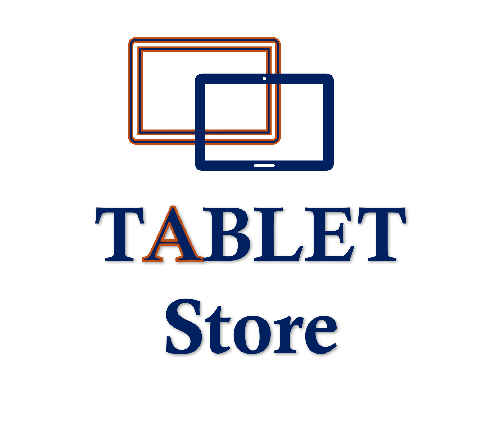

# Tablet Store

A tablet shopping app with an admin panel, built with **Flutter** and **Firebase**.
Customers browse products, fill a cart and check out. Admins manage the catalog.

<p align="center">
  
</p>

## Features

**Customers**
- Sign up, sign in and sign out with Firebase Authentication
- Live product grid streamed from Cloud Firestore
- Product details page
- Cart with quantity controls and a running total (OMR)
- Checkout that saves the order, and a purchase history screen

**Admins**
- Role-based access: the role is read from Firestore, not hard-coded in the app
- Add, update and delete tablets
- Form validation and a delete confirmation dialog

## Tech stack

| Area | Choice |
| --- | --- |
| UI | Flutter, Material 3 |
| State management | Provider (`ChangeNotifier`) |
| Authentication | Firebase Auth (email and password) |
| Database | Cloud Firestore |
| Quality | `flutter_lints`, unit tests, GitHub Actions CI |

## Architecture

The code is split into layers so UI, state and data access stay independent.

```
lib/
├── main.dart                 # Entry point and Firebase initialisation
├── app.dart                  # Providers, theme and root widget
├── core/
│   ├── config/               # Firebase config injected at build time
│   ├── constants/            # App constants, Firestore paths, roles
│   ├── theme/                # Colors and Material theme
│   └── utils/                # Validators and formatters
├── models/                   # Product, AppUser, CartItem, PurchaseOrder
├── services/                 # Firebase access: auth and repositories
├── providers/                # AuthController, CartProvider
├── screens/
│   ├── auth_gate.dart        # Picks the first screen from auth state and role
│   ├── auth/                 # Welcome, login, register
│   ├── home/                 # Product grid and details
│   ├── cart/                 # Cart and purchase history
│   └── admin/                # Product list and add/update form
└── widgets/                  # Reusable UI pieces
```

Screens never call Firebase directly. They use repositories and providers.

## Getting started

### Prerequisites
- Flutter 3.29 or newer (Dart 3.7)
- A Firebase project with **Authentication (Email/Password)** and **Cloud Firestore** enabled

### 1. Generate the platform folders
This repository contains the Dart code only. Create the platform projects once:

```bash
flutter create . --platforms=web,android,ios
flutter pub get
```

### 2. Add your Firebase values
Keys are not stored in the repo. Copy the example file and fill it in
(Firebase console → Project settings → Your apps):

```bash
cp env.example.json env.json
```

`env.json` is git-ignored.

### 3. Run

```bash
flutter run --dart-define-from-file=env.json
```

### 4. Deploy the Firestore rules

```bash
firebase deploy --only firestore:rules
```

The rules are in [`firestore.rules`](firestore.rules). Restrict your Firebase web API key
to your own domains in the Google Cloud console.

## Creating an admin

Roles can only be granted from the Firebase console, never from the app:

1. Register the account in the app.
2. In Firestore, open `users/{uid}` for that account.
3. Set the field `role` to `admin`.

## Firestore data model

| Path | Fields |
| --- | --- |
| `item/{id}` | `itemCode`, `itemName`, `itemPrice`, `brand`, `Improduct` (image URL) |
| `users/{uid}` | `name`, `email`, `role` (`user` or `admin`), `createdAt` |
| `users/{uid}/history/{id}` | `timestamp`, `totalPrice`, `items[]` (`itemCode`, `itemName`, `quantity`, `price`) |

## Tests

```bash
flutter test
```

Unit tests cover the validators, the cart logic and the product model.
CI runs `flutter analyze` and `flutter test` on every push and pull request.

## Roadmap

- Repository tests with `fake_cloud_firestore`
- Product search and brand filter
- Image upload to Firebase Storage
- Arabic localisation and RTL support

## Screenshots

Add screenshots to `docs/screenshots/` and link them here.
